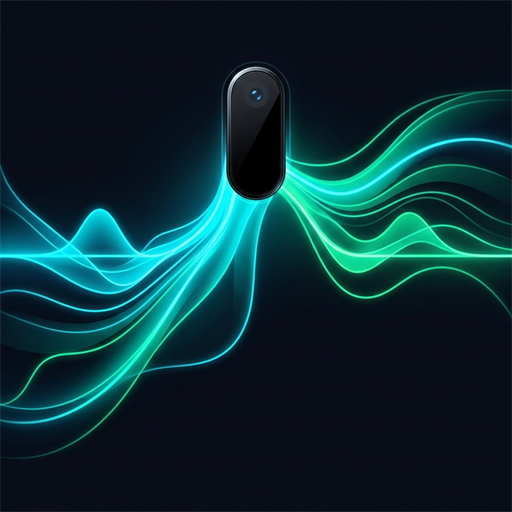
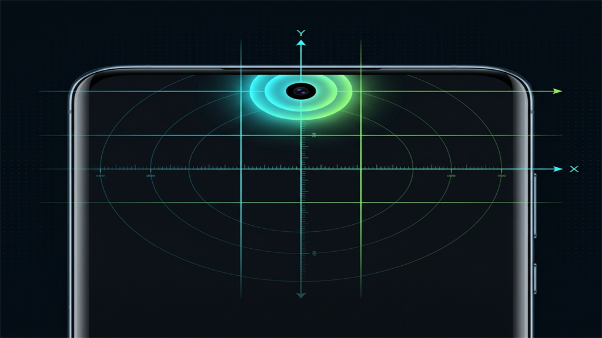

# 🌊 NotchFlow Max

<p align="center">
  
</p>

<p align="center">
  <strong>Production-ready Native Android application transforming your device's camera notch into an intuitive gesture-powered control center with Flow Capsule HUD.</strong>
</p>

<p align="center">
  <a href="https://github.com/Mohamed-maxX/NotchFlow-Max/releases"></a>
  <a href="https://developer.android.com/jetpack/compose"></a>
  <a href="https://kotlinlang.org"></a>
  <a href="https://raw.githubusercontent.com/Mohamed-maxX/NotchFlow-Max/main/version.json"></a>
</p>

---

<p align="center">
  
</p>

---

## 🌟 Overview & Highlights

**NotchFlow Max** transforms any camera cutout (center punch-hole, left/right punch-hole, waterdrop notch, or dynamic pill) into an invisible, responsive tactile command surface. Built 100% natively using **Kotlin**, **Jetpack Compose (Material 3)**, **Coroutines**, and **Preferences DataStore**, with zero bloated dependencies.

### 📱 Core UI Architecture: 3-Card Dark Dashboard
The application features a minimalist, cyber-neon dark dashboard with three cohesive cards:
1. **Service Status & Permissions Card:**
   - Single-tap master toggle to enable or suspend notch gesture detection.
   - Live permission monitoring with status badges for `SYSTEM_ALERT_WINDOW` (Overlay) and `AccessibilityService`.
   - Direct button to request exemption from Android battery optimization to prevent background kills.
2. **Notch Calibration Card:**
   - Sliders for **X Position** (-180dp to +180dp), **Y Position** (0dp to 100dp), **Width** (30dp to 250dp), **Height** (30dp to 140dp), and **Corner Radius** (0dp to 60dp).
   - 1-Tap Quick Presets: *Center Punch Hole*, *Left Punch Hole*, *Right Punch Hole*, *Dynamic Pill*, and *Waterdrop*.
   - **Preview Overlay Switch:** Illuminates the touch detection zone in neon-green (`#00FF66`) with a subtle glow for effortless alignment. When toggled OFF, it turns **100% transparent and invisible** for everyday use.
3. **Gestures & Actions Card:**
   - Assign actions to 6 distinct gestures:
     - 👆 **Single Tap**
     - ✌️ **Double Tap**
     - ⏱️ **Long Press**
     - 👈 **Swipe Left**
     - 👉 **Swipe Right**
     - 👇 **Swipe Down**
   - Available Actions:
     - 📸 **Take Screenshot** (via Accessibility `GLOBAL_ACTION_TAKE_SCREENSHOT`)
     - 🔦 **Toggle Flashlight** (via `CameraManager`)
     - 🔒 **Lock Screen** (via Accessibility `GLOBAL_ACTION_LOCK_SCREEN`)
     - 🔔 **Pull Down Notifications**
     - ⚙️ **Open Quick Settings**
     - ⚡ **Open Power Menu**
     - ⏯️ **Media Play / Pause**
     - ⏭️ **Next Track**
     - ⏮️ **Previous Track**
     - 🔕 **Ringer Mode Cycle** (*Normal* ➡️ *Vibrate* ➡️ *Silent*)
     - 💊 **"Flow Capsule" HUD:** An interactive mini-overlay expanding smoothly below the camera notch with live brightness and volume sliders, flashlight toggle, instant screenshot button, and media controls.

### 🧠 Smart UX
- **Subtle Haptic Feedback:** Customizable micro-vibrations (`VibrationEffect.EFFECT_CLICK` / `EFFECT_TICK`) confirm gesture detection.
- **Auto-Pause in Fullscreen Landscape:** Intelligent orientation sensing automatically hides and disables the touch listener during horizontal gaming and video playback (YouTube, Netflix) to prevent accidental touches.

---

## 🚀 Direct OTA Auto-Update System (GitHub Integration)

NotchFlow Max features an integrated, self-contained Over-The-Air (OTA) update system (`UpdateManager.kt`):
- **On Startup:** Silently queries the remote `version.json` file on the `main` branch:
  ```
  https://raw.githubusercontent.com/Mohamed-maxX/NotchFlow-Max/main/version.json
  ```
- **TopAppBar Trigger:** Tap the **OTA Update** button anytime to check for updates on demand.
- **Root `version.json` Configuration:**
  ```json
  {
    "versionCode": 1,
    "versionName": "1.0.0",
    "apkUrl": "https://github.com/Mohamed-maxX/NotchFlow-Max/releases/latest/download/NotchFlowMax.apk",
    "changelog": "الإصدار الأول من تطبيق NotchFlow Max - تحكم كامل بفتحة الكاميرا وإيماءات ذكية وشريط Flow Capsule السريع"
  }
  ```
- **In-App Installation:** If `remoteVersionCode > BuildConfig.VERSION_CODE`, a Material 3 dialog appears with the release notes and a **Download & Install** button. The app downloads the APK in a background coroutine with live percentage tracking, generates a secure `FileProvider` content URI, and launches Android's native package installer.

---

## 🛠️ Tech Stack & Architecture

- **Language:** Kotlin 2.0+
- **UI Framework:** Jetpack Compose (Material 3 Dark Palette)
- **Architecture Pattern:** MVVM (Model - View - ViewModel) + Clean Unidirectional Data Flow (UDF)
- **State Management:** Kotlin Coroutines `StateFlow` + `Preferences DataStore`
- **Background Engine:** WindowManager Foreground Service + Global Accessibility Service
- **Hardware Integrations:** Camera2 API (Torch Mode), AudioManager (Media keys & ringer state), VibratorManager (Haptics)
- **Minimum SDK:** Android 8.0 Oreo (API 26)
- **Target SDK:** Android 15 (API 35)

---

## 📂 Project Directory Structure

```
NotchFlow-Max/
├── art/                                # Generated visual assets & screenshots
│   ├── app_icon.png                    # High-res 512x512 app icon
│   └── calibration_preview.png         # Vector calibration illustration
├── version.json                        # OTA release descriptor for GitHub
├── build.gradle.kts                    # Root Gradle configuration
├── settings.gradle.kts                 # Project modules & repository settings
├── gradle.properties                   # JVM optimization flags
├── gradle/
│   ├── libs.versions.toml              # Version catalog
│   └── wrapper/
│       ├── gradle-wrapper.jar
│       └── gradle-wrapper.properties
└── app/
    ├── build.gradle.kts                # App module dependencies & SDK targets
    ├── proguard-rules.pro
    └── src/main/
        ├── AndroidManifest.xml         # Permissions, services & FileProvider
        ├── assets/                     # Packaged visual assets
        ├── res/
        │   ├── drawable/               # Adaptive icons & banners
        │   ├── mipmap-*/               # Multi-density app launcher icons
        │   ├── values/                 # English strings, colors, themes
        │   ├── values-ar/              # Complete Arabic localization
        │   └── xml/                    # Accessibility & FileProvider paths
        └── java/com/max/notchflowmax/
            ├── MainActivity.kt         # Edge-to-edge Compose host
            ├── NotchFlowApp.kt         # Application lifecycle anchor
            ├── data/
            │   ├── GestureAction.kt    # Supported action catalog
            │   ├── GestureType.kt      # Touch gestures enumeration
            │   ├── NotchConfig.kt      # Configuration data model
            │   └── PreferencesRepository.kt # Reactive DataStore persistence
            ├── service/
            │   ├── NotchFlowAccessibilityService.kt # Global system actions
            │   ├── NotchOverlayService.kt # WindowManager touch listener engine
            │   ├── FlowCapsuleOverlay.kt # Dynamic Island / HUD mini-overlay
            │   ├── ActionExecutor.kt   # System action dispatcher
            │   ├── OrientationWatcher.kt # Fullscreen landscape detector
            │   └── BootReceiver.kt     # Auto-start on boot receiver
            ├── ui/
            │   ├── theme/              # Color, Type, Theme (Cyber-Neon Dark)
            │   ├── components/         # GlowCard, Slider, Dropdown, ToggleRow
            │   ├── screens/            # Dashboard, Calibration, Gestures, Dialog
            │   └── viewmodel/          # MainViewModel & MainUiState
            ├── update/
            │   ├── UpdateInfo.kt       # OTA release model
            │   ├── UpdateStatus.kt     # OTA state sealed interface
            │   └── UpdateManager.kt    # GitHub release fetcher & APK installer
            └── util/
                ├── HapticHelper.kt     # Micro-haptics vibration manager
                ├── PermissionHelper.kt # Permission checks & system intents
                └── FlashlightController.kt # Camera2 torch controller
```

---

## 🔒 Permissions & Security Transparency

| Permission | Purpose |
| :--- | :--- |
| `SYSTEM_ALERT_WINDOW` | Renders the touch overlay zone around the camera cutout and the Flow Capsule HUD. |
| `BIND_ACCESSIBILITY_SERVICE` | Dispatches system actions (Screenshots, Lock Screen, Notifications, Quick Settings, Power Menu). |
| `REQUEST_IGNORE_BATTERY_OPTIMIZATIONS` | Ensures continuous touch responsiveness without OEM background kills. |
| `CAMERA` / `FLASHLIGHT` | Controls device torch mode for the flashlight action toggle. |
| `VIBRATE` | Provides haptic click confirmation upon gesture triggers. |
| `INTERNET` | Checks `version.json` on GitHub and downloads verified OTA updates. |
| `REQUEST_INSTALL_PACKAGES` | Invokes the Android package installer to install downloaded updates. |

---

## 🌍 Arabic Localization (التوافق مع اللغة العربية)

يحتوي التطبيق على دعم كامل للغة العربية ومطابق للاتجاهات من اليمين إلى اليسار (RTL):
- ترجمة كاملة لجميع البطاقات، الإعدادات، وأسماء الإيماءات والإجراءات في `res/values-ar/strings.xml`.
- دعم التحديث التلقائي المباشر من خلال ملف `version.json` وسجل التغييرات باللغة العربية.

---

## 📦 How to Build & Run

### Prerequisites
- Android Studio Ladybug / Meerkat (or newer)
- JDK 17+
- Android SDK 35

### Build Steps
```bash
# Clone the repository
git clone https://github.com/Mohamed-maxX/NotchFlow-Max.git
cd NotchFlow-Max

# Build Debug APK
./gradlew assembleDebug

# Build Release APK
./gradlew assembleRelease
```
The compiled APK will be located at:
`app/build/outputs/apk/debug/app-debug.apk`

---

## 📄 License
This project is licensed under the Apache 2.0 License.
Developed with ❤️ by **Mohamed-maxX**.
